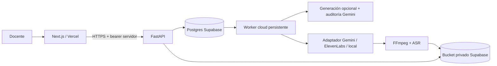

# Arquitectura

GitHub contiene código, lockfiles, pruebas, infraestructura y documentación. Vercel sirve la UI y un proxy; nunca ejecuta el procesamiento largo. API y worker pueden desplegarse como dos servicios en Render, Railway, Fly.io, Cloud Run Jobs o un contenedor con supervisión. El worker de polling debe permanecer activo o ser disparado por un scheduler; un contenedor que escala a cero sin trigger no procesa una cola por sí mismo. Ninguna tarea de producción depende de una terminal de Codex.

## Contratos de fidelidad

- `source` y `program` originales inmutables por la API de edición. Cada bloque contiene offsets de caracteres, línea y camino de títulos. El texto no se descarta por duración ni por relevancia estimada.
- Una matriz explícita `program point -> source block IDs` es obligatoria. El matcher sólo propone asociaciones; el docente las revisa. La cifra de cobertura es estructural, no una medición de corrección semántica.
- `source`: afirmación original, conservada literalmente. El cotejo detecta diferencias, incluyendo números y negaciones. Incluso una mejora estilística queda bloqueada si rompe la literalidad.
- `question`: plantilla basada en el título o pregunta IA sujeta a revisión semántica.
- `analysis`: explicación propuesta por IA con referencias originales y veredicto de otra llamada. El modelo auditor puede ser configurable por separado. No es garantía independiente de verdad: dos llamadas al mismo proveedor pueden compartir errores.
- `example`: requiere prefijo “Ejemplo inventado:”, fuente para la regla doctrinaria y veredicto semántico vigente. Un usuario no puede introducir ese veredicto mediante el editor.
- Una eventual `external` no pasa el gate: el MVP no consulta leyes/sentencias ni certifica vigencia. No se confunde una cita del apunte con verificación normativa externa.
- Todo bloque original debe estar presente en un turno `source` válido, aun cuando haya explicaciones adicionales. La ampliación no puede convertirse silenciosamente en resumen.
- Los fallos sustanciales bloquean aprobación y TTS. La reparación automática disponible es conservadora: restaura desde la fuente, conserva la evidencia del fallo y no inventa una doctrina alternativa. Las correcciones semánticas complejas necesitan revisión o una nueva propuesta.

## Versiones y estados

`aas_episodes` conserva la versión actual; `aas_revisions` guarda snapshots completos (costoso para corpus grandes, adecuado para MVP). Escrituras con revisión optimista: una pestaña vieja recibe 409. La aprobación firma con SHA-256 fuente, programa, matriz, segmentos, ritmo, duración y diccionario. Cualquier edición invalida aprobación.

Los jobs contienen un snapshot: `queued -> running -> done/failed`. Claim por compare-and-swap, lease de 30 minutos renovado entre segmentos, token de propietario y hasta tres intentos para recuperar un worker muerto. Un índice parcial único evita dos trabajos activos simultáneos por unidad. Errores operativos persistidos no incluyen cabeceras ni URLs de credenciales. No se reintenta un fallo de cuenta indefinidamente.

Un job de ampliación entrega una propuesta; aplicar es una acción explícita contra la misma versión base. No modifica silenciosamente un guion que el usuario esté editando. Un job de audio no reescribe el guion. La descarga rechaza audio de una revisión anterior.

## Audio

Cache key: texto hablado + voz + ritmo + proveedor + versión/configuración de motor. El texto hablado deriva del guion aprobado y diccionario, sin modificar el guion académico. Dos voces fijas por job. No se cambia de proveedor por un error.

PCM normalizado a mono 24 kHz; fades de 8 ms en extremos y pausa de 120 ms. No se superponen fonemas de turnos distintos. Concatenación y normalización EBU R128 con FFmpeg, salida MP3 128 kbps. La continuidad perceptiva y el acento argentino siguen requiriendo escucha.

ASR opcional por segmento mediante faster-whisper, sin recibir el texto objetivo como prompt. Comparación de secuencia, cifras y negaciones contra el texto efectivamente sintetizado. El informe mantiene transcripción, similitud y discrepancias por segmento. La evaluación puede dar falsos positivos por normalización de números, latín o siglas; no se aprueban automáticamente. Falta alineación fonética especializada y detección semántica de errores que no cambian tokens. Un borrador sin ASR se puede escuchar/descargar para revisión; un audio sólo se considera verificado cuando todos los segmentos pasan. El guion nunca se ofrece como si fuera una transcripción obtenida del audio.

## Seguridad y alcance operativo

MVP de **un espacio privado**, no multitenant: login HTTP Basic sobre HTTPS en Next.js, token interno en API, DB sólo accesible por backend, bucket privado y sin políticas públicas. Producción falla cerrada si faltan credenciales de acceso. Nunca usar service_role en un componente cliente ni una variable `NEXT_PUBLIC_*`.

Persistencia de desarrollo: SQLite y archivos locales; en producción Supabase/Postgres y bucket privado. ORM soporta ambos. PostgreSQL y Storage no se probaron con credenciales reales aquí; SQL de RLS y adaptador incluidos. El rol DB server controla el workspace completo. Para varios usuarios/organizaciones es obligatorio el siguiente paso de Auth + ownership + RLS por tenant antes de abrir registro público.

Importación máxima MVP: 1 MB por fuente en UI y 2 MB por petición backend. Sólo Markdown/texto UTF-8; no hay parser PDF inseguro expuesto. Los datos del usuario se tratan como datos en prompts; el modelo nunca ejecuta herramientas, consultas SQL ni comandos del material. Texto no se renderiza como HTML. Secretos quedan en configuración del host y sólo se inspecciona presencia. Artefactos y `.env` están fuera de Git. Definir retención/borrado/cifrado/backups y acuerdo de tratamiento de datos antes de un servicio público.
